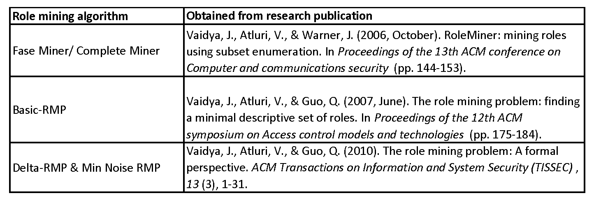

# Role-Mining-Algorithms from the literature

Java implementations of role mining algorithms from the role-based access control (RBAC) literature, run on a dataset of Android apps and the permissions they request. Role mining takes a table of which users hold which permissions and looks for a smaller set of roles (sets of permissions) that describes it. Here each app plays the part of a user.

This is research and teaching code. It is for people who want to read, run or compare these algorithms on a 0/1 user-permission matrix.



The role sets produced by the original authors' earlier runs are in the `Output/` directory.

## Requirements

- JDK 17 or later
- make

There are no other dependencies. The build uses plain `javac`, and the tests use a small runner included in the repository.

## Quick start

Build and run the tests:

```
make build
make test
```

Run an algorithm on the bundled 500-app dataset and write the result files to `result/`:

```
./rolemine --algo fastminer --input data/android-500/upa.csv \
    --perms data/android-500/permissions.csv --users data/android-500/apps.txt \
    --out result
```

`./rolemine` compiles the project on first use if `out/main` does not exist. `./rolemine --list` prints the algorithms available in the current build.

## Command line

```
usage: rolemine --algo NAME --input UPA.csv [--perms FILE] [--users FILE]
                [--out DIR] [--param name=value ...]

  --input   0/1 matrix, one row per user, comma separated
  --perms   permission names, one per column: one per line, or one comma-separated line
  --users   user names, one per row, same format
  --out     directory for roles.csv, assignments.csv, metrics.txt
  --list    print algorithm names
```

`--help` (or `-h`) prints this text and the list of algorithms with their parameters. `--param` may be repeated; each value is `name=value`, and which names an algorithm understands is given in its description in `--help`. `--algo` and `--input` are required. A usage error exits with status 2.

`make jar` also builds `out/rolemine.jar`, which can be run with `java -jar out/rolemine.jar` and the same options.

## Input format

**Matrix** (`--input`): a text file with one row per user and one comma-separated value per permission, each value `0` or `1`. The loader accepts:

- blank lines (ignored)
- spaces around values
- trailing commas
- LF or CRLF line endings
- UTF-8, UTF-8 with a byte order mark, and UTF-16 (little or big endian) with a byte order mark. A file without a byte order mark is read as UTF-8.

Every row must have the same number of values as the first. A value other than 0 or 1, or a row of a different length, is an error that names the file and line number. Trailing commas are allowed, but an empty value in the middle of a row is an error.

**Permission names** (`--perms`) and **user names** (`--users`): optional. Either one name per line, or all names on a single comma-separated line. A file with exactly one line is split on commas, unless the matrix has exactly one permission (or user). The number of names must equal the number of columns (or rows), otherwise loading fails. User names that contain commas, such as those in `data/android-500/apps.txt`, therefore need to be given one per line. Without these files the names are generated: `u0`, `u1`, ... and `p0`, `p1`, ...

## Output

With `--out DIR`, three files are written to `DIR` (created if needed):

- `roles.csv`: header `role,size,permissions`. One row per mined role: its number (starting at 1), how many permissions it has, and the permission names joined with `;`.
- `assignments.csv`: header `role,userCount,users`. One row per role: its number, how many users hold it, and the user names joined with `;`. The list is CSV-quoted when a name contains a comma or a double quote.
- `metrics.txt`: `name=value` lines. The metrics below, then any extra numbers the algorithm reports.

The same `name=value` lines are printed to the terminal, preceded by `algorithm=NAME` and followed by `millis=` (the mining time in milliseconds).

### Metrics

Let a user's *row* be the set of permissions the matrix gives them, and let a user's *rebuilt row* be the union of the roles they are assigned.

- `users`, `permissions`: size of the matrix.
- `upaCells`: number of 1 cells in the matrix.
- `roles`: number of roles returned.
- `coveredCells`: 1 cells whose permission is in the user's rebuilt row.
- `underAssigned`: 1 cells whose permission is not in the user's rebuilt row.
- `overAssigned`: permissions in a user's rebuilt row that are 0 in the matrix.
- `distance`: `underAssigned + overAssigned`, the number of cells where the roles and the matrix disagree. 0 means the roles describe the matrix exactly.
- `permissionsUsed`: number of distinct permissions that appear in at least one role.

Which users hold which roles is taken from the algorithm if it returns an assignment. If it returns roles only, each user is given every role whose permissions are all in the user's row; an empty role is given to nobody. With that rule `overAssigned` is always 0.

## Algorithms

<!-- ALGORITHMS: filled in by the coordinator from the miners' notes -->

## Bundled datasets

See `data/README.md` for details.

- `data/android-500/`: `upa.csv`, a matrix of 500 rows (apps) by 582 columns (permissions) with 7598 cells set to 1; `permissions.csv` with the 582 permission names; `apps.txt` with the 500 app names.
- `data/android-5000/upa-utf16.csv`: a 5000 by 592 matrix, UTF-16, without name files.
- `data/legacy/combine-utf16.csv`: an older 497 by 542 matrix, UTF-16, without name files.

## Repository layout

```
src/main/java/rolemining/core/   matrix loading, miner interface, metrics, result files
src/main/java/rolemining/cli/    command line (Main) and the list of miners (Miners)
src/test/java/                   tests and the small test runner
src/test/resources/fixtures/     small matrices used by the tests
data/                            bundled datasets
Output/                          result files from the original authors' runs
Makefile, rolemine               build and launcher
```

## Adding an algorithm

1. Implement `rolemining.core.RoleMiner`: `name()` (lower case, used with `--algo`), `description()` (one line: what it does and its parameters with defaults) and `mine(UpaMatrix, MinerOptions)`, which returns a `MiningResult`. Return roles only, or roles plus the user assignment. Do not keep state between calls.
2. Add the fully qualified class name to the `CLASSES` array in `src/main/java/rolemining/cli/Miners.java`. Classes not found at run time are skipped.
3. Add tests under `src/test/java`. Test classes are named `*Test`; every public, non-static, no-argument `void` method in them is run by `make test`. Assertions are in `rolemining.testing.Check`.

## References

- Jaideep Vaidya, Vijayalakshmi Atluri and Janice Warner. RoleMiner: mining roles using subset enumeration. In Proceedings of the 13th ACM Conference on Computer and Communications Security (CCS '06), pages 144-153, ACM, 2006. DOI 10.1145/1180405.1180424.
- Jaideep Vaidya, Vijayalakshmi Atluri and Qi Guo. The role mining problem: finding a minimal descriptive set of roles. In Proceedings of the 12th ACM Symposium on Access Control Models and Technologies (SACMAT '07), pages 175-184, ACM, 2007. DOI 10.1145/1266840.1266870.

## License

There is currently no license file in this repository, so no permission to copy, modify or redistribute the code or data is granted beyond what the law allows by default. Choosing a license is on the to-do list (`TODO.md`).

## Citing

See `CITATION.cff`. If you use the algorithms themselves, cite the papers listed above as well.
